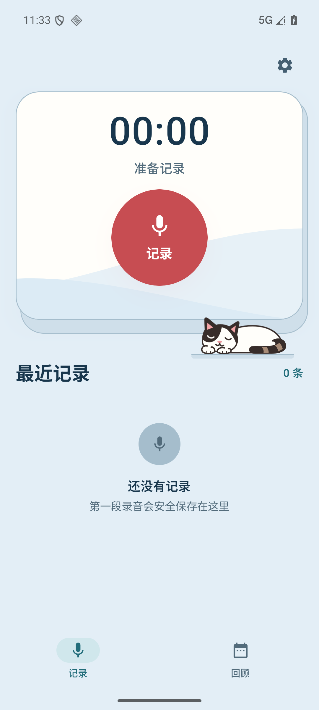
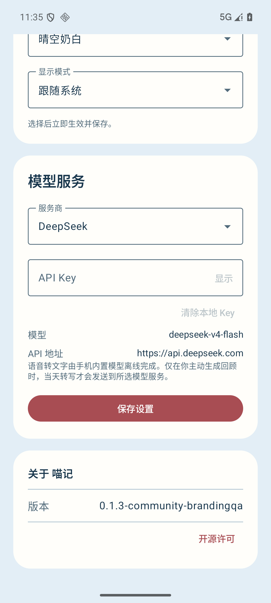

# 喵记（DailyM）

一个用于个人随记上下文的小工具，也是一个 AI 时代的日记小工具。

目前基于 Android 开发。你可以随时记录每天的见闻、想法和感悟，保存在自己的手机里；需要时，使用自己配置的云端模型整理归纳，留下每天的结构化上下文。

如果喜欢这个项目，欢迎点一个 Star ⭐。如果有好的意见和建议，欢迎通过 [GitHub Issues](https://github.com/qinjunw/DailyM/issues) 联系交流。谢谢！

## 界面预览

| 记录首页 | 模型服务与关于 |
| --- | --- |
|  |  |

截图来自 2026-10-18 的 Android 16 模拟器独立测试安装，展示已进入主干的 `0.1.3` 界面；使用空白测试数据，不含私人记录或 API Key。它们不是已发布的 `0.1.2` APK 截图，来源见 [截图说明](docs/screenshots/README.md)。

## 当前功能

- 手动录音、播放、按日查看和删除录音。
- APK 内置 SenseVoiceSmall INT8 模型，语音转文字在手机离线完成。
- 使用 DeepSeek 预设，或自填 HTTPS API 地址、模型名称和 API Key，通过 OpenAI 兼容 Chat Completions 接口生成每日回顾。
- 回顾包含标题、摘要、主题、想法、问题、决定和待办；本地保存整份回顾与生成时输入录音的关联，正文不提供逐观点引用。
- API Key 经 Android Keystore 加密后保存在应用私有存储；离开设置页会清除明文输入草稿，已保存的 Key 仍可供回顾任务使用。
- 晴空奶白、奶油海盐、雾紫蓝三组主题，可跟随系统或固定日间、夜间，选择自动保存在本机。
- 记录页和回顾页加入趴睡皮蛋，身体呼吸起伏、轻微点头并间歇摆尾。记录页录音期间暂停皮蛋动画；页面进入后台或系统关闭动画时保持静止。

当前只支持 `arm64-v8a` 设备，最低 Android 6.0（API 23）。这是早期社区版本，自动化检查与设备验证范围见 [验证记录](docs/VERIFICATION.md)。

## 版本与下载

| 版本 | 获取方式 | 差异与状态 |
| --- | --- | --- |
| 主干 `0.1.3-community` / code 5 | [从源码构建](#从源码构建) | 包含“喵记 / DailyM”命名、紧凑首页和 Release 离线转写修复；尚未发布对应 APK |
| 已发布 `0.1.2-community` / code 4 | [Release](https://github.com/qinjunw/DailyM/releases/tag/v0.1.2-community) · [ARM64 APK](https://github.com/qinjunw/DailyM/releases/download/v0.1.2-community/PerContext-Community-0.1.2-arm64.apk) · [SHA256SUMS.txt](https://github.com/qinjunw/DailyM/releases/download/v0.1.2-community/SHA256SUMS.txt) | 预发布，仍为旧品牌和旧首页；不含主干的 JNI 修复 |

**已知问题：** 已发布 `0.1.2` 的 Release 混淆可能使 SenseVoice 在初始化时出现 `NoSuchFieldError`，导致离线转写失败。主干 `0.1.3` 已加入原生接口保留规则；需要此修复时请从源码构建。两者均内置离线模型，详细故障与验证范围见 [验证记录](docs/VERIFICATION.md)。

已安装本仓库社区版的用户，使用同包名、同发布证书且版本代码不降低的 Release 包时，可覆盖安装以保留应用数据。不能用 `0.1.2` / code 4 降级覆盖 `0.1.3` / code 5。升级前无需卸载；卸载会清除时间线、转写、回顾和设置。

自行构建的 Debug 包或使用另一签名的 Release 包不能直接覆盖官方签名安装。先在独立测试环境使用，避免为解决签名冲突而卸载含有个人数据的 App。

## 使用

**录音和离线转写无需 API Key；Key 仅用于生成每日回顾。** 以下步骤按主干 `0.1.3` 的行为说明。

1. 打开 App，点击「记录」并授予麦克风权限；Android 6–9 还需授予存储权限。Android 13 及以上会申请通知权限，用于显示录音状态；拒绝通知权限仍可录音。停止后，录音出现在时间线。
2. 点击录音的转写按钮。首次转写会把 APK 内的模型校验并安装到应用私有目录，随后离线识别。
3. 点击右上角齿轮进入设置。选择 DeepSeek 预设，或选择「自定义 OpenAI 兼容服务」。
4. 填写所选服务的 API Key。自定义服务还需填写 API Base URL 和模型名称：地址示例为 `https://api.example.com/v1`，模型名称必须使用服务提供方给出的模型 ID。
5. 保存后打开「回顾」，选择有成功转写的日期，点击生成当天回顾。月历标记“有录音”不代表当天已完成转写。

原始转写是首次成功识别的快照，当前不能编辑或重新转写成功结果。每天只保存一份当前回顾，刷新成功会替换它；来源改变时会提示确认已备份，但 App 目前尚无完整导出与恢复功能。

在「设置 → 外观」选择主题与显示模式，选择后自动生效，无需点击模型服务的「保存设置」。默认使用晴空奶白并跟随系统；外观设置与模型服务配置分开保存。

地址会自动补全 `/chat/completions`；也接受以该路径结尾的完整接口地址。当前要求 HTTPS，地址中不能包含账号、查询参数或片段。自定义服务需支持非流式 Chat Completions、`response_format: {"type":"json_object"}`，并返回 `choices[].message.content` 及 `finish_reason: "stop"`。

更换 API 地址时需重新输入 Key；仅修改模型名称可沿用该地址的已保存 Key。接口重定向会被拒绝。模型服务的费用和使用额度由你所选的提供方决定。

「清除本地 Key」会立即删除当前服务在本机保存的 Key，不会撤销服务提供方的 Key。

## 数据保存在什么地方

原始音频位于手机公共 `Download/PerContext/Recordings` 目录，录音索引、转写和每日回顾保存在应用本地数据库中。语音转文字不上传音频。

主动生成或刷新回顾会创建联网任务；任务执行时读取请求日期的成功转写与当时保存的模型配置，将转写正文、日期、时区、各段录音时刻及来源编号发送到该模型服务，不发送原始音频。离线任务会等待联网，并可在后台执行；排队期间修改来源或模型配置会影响实际请求。对方如何处理内容，取决于该服务的政策。App 不会自行创建回顾任务。

删除录音会移除时间线中的录音、对应转写和回顾来源关联，并尽力删除受管音频文件；文件删除失败时原文件可能仍在公共目录。已生成的回顾正文仍保留，但不能借它恢复已删除的完整来源，也不保证每条观点都有独立引用。刷新回顾失败或取消时保留上次成功正文。

卸载 App 会移除应用数据库和设置，公共目录中的原始录音仍保留；重新安装不会自动重建旧时间线。社区版包名为 `com.percontext.community`，使用独立应用数据。

当前没有账号、云同步或完整数据导出恢复，Android 自动备份亦关闭。公共音频留存不等于转写和回顾已备份；若要保留某次回顾，应在刷新或卸载前另行保存需要的文字。

产品与仓库已更名为喵记 / DailyM；包名、`PerContext-Community` Gradle 工程名、`percontext` 构建参数和 `Download/PerContext/Recordings` 路径继续沿用，以保留现有安装和数据的兼容性。

## 从源码构建

需要与仓库 Gradle Wrapper 兼容的 JDK（最低 17）、Android SDK Platform 37、Python 3.10 或更高版本。通过 `JAVA_HOME` 或 `PATH` 提供 JDK，通过 `ANDROID_HOME` 或本地 `local.properties` 指定 Android SDK。使用仓库自带的 Wrapper，无需全局安装 Gradle。

```sh
git clone https://github.com/qinjunw/DailyM.git
cd DailyM
```

先获取固定模型包：

```sh
python tools/fetch_sensevoice.py
```

脚本从 sherpa-onnx 官方 Release 下载模型，验证文件长度与 SHA-256 后写入 Git 忽略的 `local-models/models/`。模型权重不存入 Git，但会进入构建出的每个 APK。下载约 163 MB，解压后的模型和词表约 240 MB。

首次构建还需要联网获取 Gradle 和依赖；App 的离线转写不代表源码可在未准备依赖时离线构建。已有相同模型文件时，获取脚本只校验并复用。

Windows：

```powershell
.\gradlew.bat :app:testDebugUnitTest :app:lintDebug :app:assembleDebug
```

macOS/Linux：

```sh
./gradlew :app:testDebugUnitTest :app:lintDebug :app:assembleDebug
```

Debug APK 位于 `app/build/outputs/apk/debug/app-debug.apk`。也可以使用 `-Ppercontext.sensevoiceModelDir=<model-directory>` 指向已有的相同模型包，构建仍会校验模型和许可文件。

发布构建使用 `:app:assembleRelease :app:lintRelease`，启用 R8 与资源收缩。发布签名通过本地 `signing.local.properties` 配置，格式见 [签名模板](signing.properties.example)；未配置时生成未签名 Release APK。签名材料和本地配置不进入 Git。

## 开发与验证

应用代码使用 Kotlin、Jetpack Compose、Room、WorkManager、Media3、Ktor 与 sherpa-onnx。语音处理、模型调用、存储和页面通过领域接口连接。详见 [架构说明](docs/ARCHITECTURE.md) 和 [贡献说明](CONTRIBUTING.md)。

## 许可证

本项目原创源码使用 [Apache License 2.0](LICENSE)。第三方代码与模型保留各自的许可，见 [NOTICE](NOTICE)。

SenseVoiceSmall 模型权重使用随包保留的 [FunASR Model Open Source License Agreement 1.1](app/src/main/sensevoice-legal/MODEL_LICENSE)，并附有[模型出处与作者声明](app/src/main/sensevoice-legal/NOTICE)。项目的 Apache-2.0 许可不替代模型许可。
